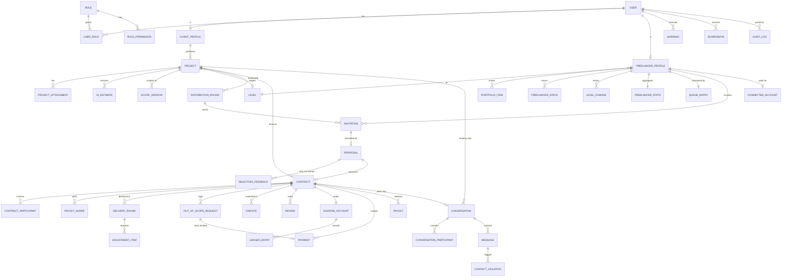
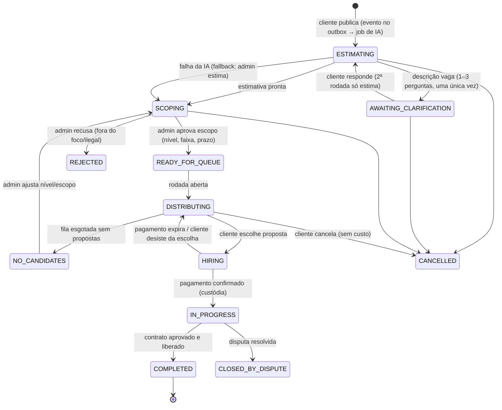
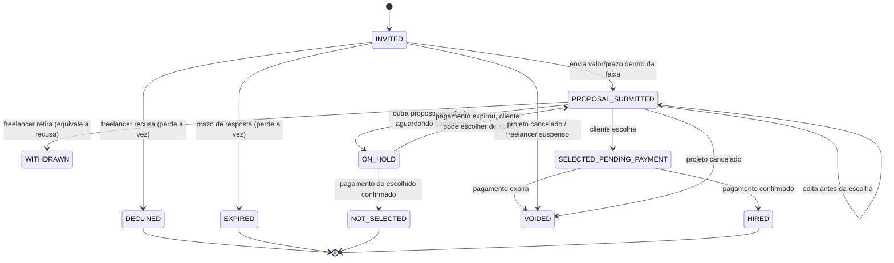
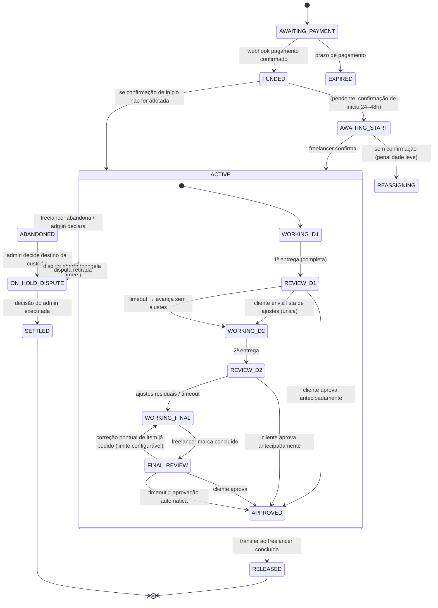
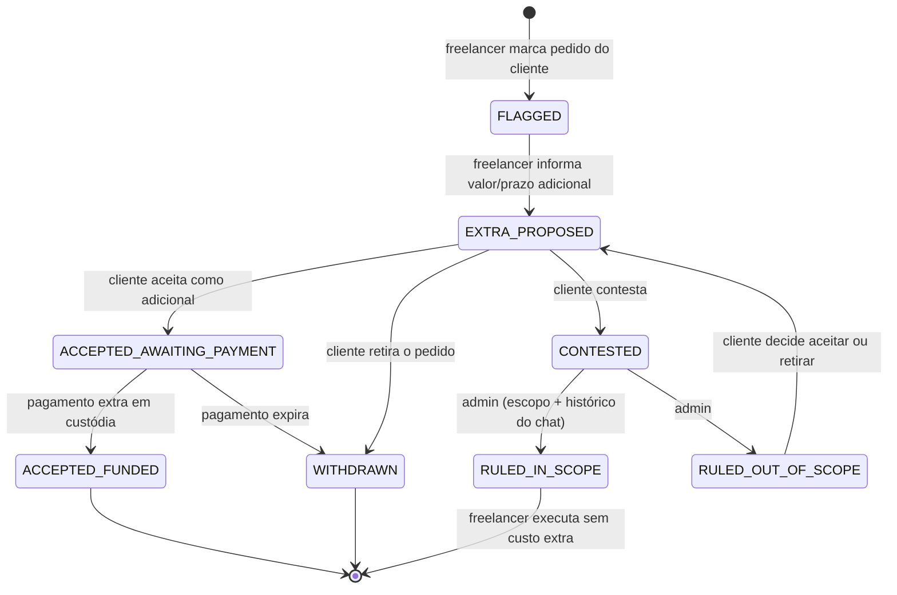
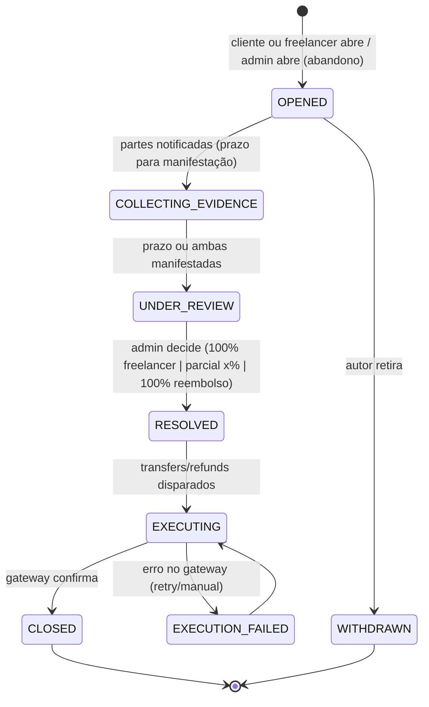

# Freelas 4 Devs — Arquitetura do MVP

> Documento vivo. Decisões individuais registradas em [`docs/adr/`](./adr/). Última revisão: 2026-10-07.

## Contexto

Marketplace concorrente do 99Freelas, focado só em desenvolvimento de software. O diferencial é uma **fila de distribuição por nível**, que dá a iniciantes a chance real de conseguir o primeiro projeto, sem vantagem paga e sem esforço extra para o cliente. O repositório `/Users/pedrofi/projects/freelas-for-devs` está vazio (greenfield). Este plano define a stack, o modelo de domínio, as máquinas de estado, o algoritmo da fila, a segurança, a estratégia de testes e o roadmap antes de qualquer implementação.

**Decisões confirmadas com o fundador:**

- Nome do produto: **Freelas 4 Devs**.
- **Comissão customizável**: percentual e quem paga (cliente, freelancer ou dividido) são `Settings` editáveis pelo Admin, com snapshot no contrato. **Valor inicial: 10%.**
- **Plano do freelancer gratuito no MVP**: não há módulo de billing no MVP; ver ADR-0012.
- Pagamento: o domínio depende de uma **porta `PaymentGateway`**. O **Stripe Connect** (separate charges & transfers) é o primeiro adapter, e um gateway brasileiro (Pagar.me/Asaas) pode entrar depois como outro adapter.
- Proposta: o freelancer define **valor e prazo livremente, desde que dentro da faixa** que o Admin aprovou.
- Rodada: **quando alguém recusa ou deixa expirar, a vaga é reposta na hora** (mantém até K convites ativos).
- Infra: **PaaS gerenciado**: Vercel (web/landing), Railway/Render/Fly (API + workers), Postgres gerenciado (Neon/Supabase), Redis gerenciado (Upstash/Railway) e Cloudflare R2.

---

## 1. Decisões de arquitetura e stack

| Tema                | Escolha                                                                                                                                            | Justificativa                                                                                                                                                                                                                                                                                                                                                                                                                                                                                                                                                                                   | Descartadas                                                                                                                                                                                                                                 |
| ------------------- | -------------------------------------------------------------------------------------------------------------------------------------------------- | ----------------------------------------------------------------------------------------------------------------------------------------------------------------------------------------------------------------------------------------------------------------------------------------------------------------------------------------------------------------------------------------------------------------------------------------------------------------------------------------------------------------------------------------------------------------------------------------------- | ------------------------------------------------------------------------------------------------------------------------------------------------------------------------------------------------------------------------------------------- |
| Monorepo            | **pnpm workspaces + Turborepo**                                                                                                                    | Instalação rápida e estrita (sem dependências fantasmas). O Turbo traz cache local/remoto (Vercel) e pipelines `lint/typecheck/test/build` só no que foi afetado. Configuração mínima.                                                                                                                                                                                                                                                                                                                                                                                                          | **Nx**: poderoso, mas opinativo e com curva maior; os plugins geram acoplamento. **npm/yarn workspaces puros**: não têm cache nem orquestração de tarefas.                                                                                  |
| Runtime             | Node 22 LTS, TypeScript 6.0 `strict` + `noUncheckedIndexedAccess` (TS 7 quando `typescript-eslint` e Nest CLI suportarem); monorepo 100% ESM       | Tipagem estrita ponta a ponta.                                                                                                                                                                                                                                                                                                                                                                                                                                                                                                                                                                  | —                                                                                                                                                                                                                                           |
| API                 | **NestJS 12** (adapter Fastify)                                                                                                                    | Pedido do produto. O Fastify tem melhor throughput e o DI do Nest fica restrito às camadas de interface e infraestrutura.                                                                                                                                                                                                                                                                                                                                                                                                                                                                       | Express adapter (mais lento, sem ganho real).                                                                                                                                                                                               |
| Banco               | **PostgreSQL 16**                                                                                                                                  | Transações ACID para dinheiro e fila, `SELECT … FOR UPDATE SKIP LOCKED` e advisory locks para concorrência na fila, JSONB para escopo e estimativa, full-text para busca simples.                                                                                                                                                                                                                                                                                                                                                                                                               | MySQL (locking menos expressivo), Mongo (precisamos de integridade relacional e transações fortes).                                                                                                                                         |
| ORM                 | **Drizzle ORM + drizzle-kit**                                                                                                                      | Fica próximo do SQL, suporta `FOR UPDATE SKIP LOCKED` e transações tipadas, não tem engine binária e as migrações SQL são versionadas e revisáveis. Combina com o Repository Pattern: o domínio não enxerga o ORM, só os mappers.                                                                                                                                                                                                                                                                                                                                                               | **Prisma**: maduro, mas locks e CTEs exigem raw SQL e os tipos gerados tendem a vazar para o domínio. **MikroORM**: Unit of Work bom para DDD, mas é mais pesado e tem menos adoção. **TypeORM**: histórico de bugs e manutenção irregular. |
| Jobs / prazos       | **BullMQ + Redis** com **Transactional Outbox** e **reconciliador por cron**                                                                       | Jobs atrasados (delayed) cuidam de timeouts de convite, auto-aprovação e prazos de pagamento. O Postgres continua sendo a fonte da verdade (`deadline_at` em cada linha). Um cron a cada minuto varre prazos vencidos e cobre jobs perdidos. O outbox garante que um evento só seja publicado se a transação commitar.                                                                                                                                                                                                                                                                          | **pg-boss** (só Postgres): opção válida, mas o Redis já é necessário para chat, rate limit e cache. **Temporal**: robusto, mas exagerado para o MVP. **Cron puro**: impreciso e não escala.                                                 |
| Tempo real          | **Socket.IO** (gateway NestJS) + **@socket.io/redis-adapter**                                                                                      | Rooms por conversa, reconexão, ack e fallback de transporte. O adapter Redis permite escalar horizontalmente. Autenticação pelo cookie no handshake. A mensagem é **persistida antes** de ser emitida. Serviço deployável separado (`api` em modo `realtime`) quando precisar escalar.                                                                                                                                                                                                                                                                                                          | **Pusher/Ably**: custo por conexão e dados de chat com terceiro (LGPD). **SSE**: unidirecional. **ws puro**: teria que reimplementar rooms e reconexão.                                                                                     |
| Arquivos            | **Cloudflare R2** (API S3) + URLs pré-assinadas                                                                                                    | Sem custo de egress. Upload direto do browser para um bucket de **quarentena**, depois job de validação (magic bytes, tamanho, ClamAV) e promoção para o bucket final. Download só por URL assinada de curta duração.                                                                                                                                                                                                                                                                                                                                                                           | S3 (egress caro), Supabase Storage (acopla ao provedor do banco).                                                                                                                                                                           |
| Autenticação        | **Solução própria no NestJS**                                                                                                                      | O papel futuro de Gerente de Projetos, o app mobile e o RBAC fino pedem controle total. A sessão mora nos nossos dados (LGPD) e não há custo por MAU. Detalhes: argon2id; **access token JWT de 15 min + refresh token opaco rotativo** (armazenado com hash e com detecção de reuso por família), ambos em **cookies httpOnly, Secure, SameSite=Lax**; OAuth com **GitHub e Google** (GitHub é natural para devs e ajuda o portfólio); verificação de e-mail; **2FA TOTP obrigatório para Admin**. O app mobile futuro usa os mesmos endpoints, com tokens no corpo e `Authorization: Bearer`. | **Clerk/Auth0**: rápidos de integrar, mas com custo, lock-in e dados de usuário fora. **Better Auth / NextAuth**: centrados no Next, acoplariam a autenticação ao front e atrapalhariam o mobile. **Keycloak**: ops pesado.                 |
| Validação/contratos | **Zod** em `packages/contracts`                                                                                                                    | Um só schema serve para validar no front (formulários), no back (decorators próprios `@ContractRoute` + `@ValidRequest`, pois o `nestjs-zod` não suporta Nest 12) e para gerar o OpenAPI (`zod-openapi`).                                                                                                                                                                                                                                                                                                                                                                                       | class-validator (duplica tipos e não é compartilhável).                                                                                                                                                                                     |
| Documentação API    | **OpenAPI 3.1** gerado dos schemas Zod + **openapi-typescript/openapi-fetch** gerando `packages/api-client`                                        | O cliente tipado é reutilizável pelo web e pelo app mobile futuro.                                                                                                                                                                                                                                                                                                                                                                                                                                                                                                                              | tRPC (acopla ao TS e não serve bem a mobile nativo nem a terceiros).                                                                                                                                                                        |
| IA (estimativa)     | Porta `ProjectEstimator`; adapter **Claude (`claude-sonnet-5-5`)** com saída estruturada (tool/JSON schema) validada por Zod                       | A estimativa roda em job assíncrono (latência de segundos) e o resultado chega por WebSocket. O prompt é versionado e cada estimativa guarda modelo, versão e tokens.                                                                                                                                                                                                                                                                                                                                                                                                                           | Chamada síncrona no request (timeout e custo sem controle).                                                                                                                                                                                 |
| E-mail              | Porta `Mailer`; adapter **Resend** + templates React Email                                                                                         | Simples, com boa entregabilidade.                                                                                                                                                                                                                                                                                                                                                                                                                                                                                                                                                               | SES (mais ops).                                                                                                                                                                                                                             |
| Observabilidade     | **pino** (nestjs-pino) em JSON com `requestId/traceId`, **Sentry** (web + api), **OpenTelemetry** para traces e métricas (Grafana Cloud free tier) | Padrão aberto, sem lock-in.                                                                                                                                                                                                                                                                                                                                                                                                                                                                                                                                                                     | Datadog (caro no início).                                                                                                                                                                                                                   |

### Estado no `apps/web`

- **Estado de servidor → TanStack Query.** Cuida de cache, deduplicação, revalidação, paginação infinita e mutações otimistas, sobre o `api-client` gerado. As páginas autenticadas são altamente interativas (chat, fila, entregas), então o RSC fica para o shell e para leituras iniciais (prefetch + `HydrationBoundary`). Eventos do Socket.IO **invalidam ou atualizam queries** (`queryClient.setQueryData`), e não um store paralelo.
- **Estado de cliente → Zustand**, mínimo: UI global (modais, sidebar) e o **rascunho de projeto pré-cadastro** (com `persist` em localStorage, versionado).
- **Estado de URL → nuqs** (filtros e paginação do painel Admin, para que sejam compartilháveis).
- **Formulários → React Hook Form + zodResolver**, com os schemas de `packages/contracts`.
- Descartados: Redux Toolkit (boilerplate, e o RTK Query duplicaria o TanStack), Context como store (re-render em cascata).

### Comunicação web ↔ api

Domínios irmãos (`app.dominio.com.br` e `api.dominio.com.br`) com cookies `Domain=.dominio.com.br` e SameSite=Lax. A proteção CSRF combina **double-submit token** (cookie não-httpOnly `csrf` + header `X-CSRF-Token`) com **checagem de `Origin`** em métodos mutáveis. Não há BFF no MVP (menos saltos), e o Next só faz proxy de nada.

---

## 2. Estrutura do monorepo

```
freelas-for-devs/
├─ apps/
│  ├─ web/                      # Plataforma (Next.js App Router + Tailwind v4)
│  │  ├─ src/app/
│  │  │  ├─ (public)/           # publicar projeto (rascunho anônimo), login, cadastro
│  │  │  ├─ (client)/           # área do cliente: projetos, propostas, entregas
│  │  │  ├─ (freelancer)/       # convites, propostas, contratos, perfil/portfólio
│  │  │  ├─ (admin)/            # painel admin (layout protegido por role)
│  │  │  └─ api/health/route.ts
│  │  ├─ src/features/<domínio>/{components,hooks,queries,schemas}.ts
│  │  ├─ src/lib/{api-client.ts,query-client.ts,socket.ts,auth.ts}
│  │  ├─ src/stores/            # zustand (ui, project-draft)
│  │  └─ middleware.ts          # gate de rotas por sessão/role (UX; a autorização real é na API)
│  ├─ api/                      # NestJS
│  │  ├─ src/
│  │  │  ├─ main.ts             # bootstrap http
│  │  │  ├─ worker.ts           # bootstrap de consumidores BullMQ (mesmo código, outro processo)
│  │  │  ├─ realtime.ts         # bootstrap só do gateway Socket.IO (escala independente)
│  │  │  ├─ shared/
│  │  │  │  ├─ kernel/          # Entity, AggregateRoot, ValueObject, Result, DomainEvent, StateMachine, Money, Clock
│  │  │  │  ├─ infra/           # db (drizzle), outbox, redis, queue, storage, mailer, crypto, logger
│  │  │  │  └─ interface/       # guards (auth, rbac, csrf), filters, interceptors, pipes zod
│  │  │  └─ modules/
│  │  │     └─ <modulo>/
│  │  │        ├─ domain/          # TS puro: entidades, VOs, máquinas de estado, eventos, ports de repositório
│  │  │        ├─ application/     # casos de uso (commands/queries), ports externos, DTOs internos
│  │  │        ├─ infrastructure/  # repositórios drizzle, mappers, adapters (stripe, claude, regex...)
│  │  │        ├─ interface/       # controllers http, gateways ws, consumers de jobs, presenters
│  │  │        └─ <modulo>.module.ts
│  │  ├─ db/{schema/*.ts, migrations/*.sql, seeds/}
│  │  └─ test/{integration,e2e,fixtures}
│  └─ landing/                  # Next.js SSG/ISR + Tailwind, zero JS onde possível
│     └─ src/app/{page.tsx, clientes/, freelancers/, como-funciona/, faq/, sitemap.ts, robots.ts, opengraph-image.tsx}
├─ packages/
│  ├─ contracts/                # schemas Zod de request/response, enums de estado, códigos de erro, eventos WS
│  ├─ api-client/               # cliente gerado do OpenAPI (openapi-fetch) — web hoje, mobile amanhã
│  ├─ ui/                       # componentes (base shadcn/Radix), tokens de design (CSS do Tailwind v4)
│  ├─ config-typescript/        # tsconfig base/strict, next, nest, lib
│  ├─ config-eslint/            # flat config: base, next, nest, regras de boundary (eslint-plugin-boundaries)
│  └─ config-vitest/            # presets de teste
├─ infra/
│  ├─ docker-compose.yml        # postgres, redis, minio (R2 local), clamav, mailpit, stripe-cli
│  └─ deploy/                   # Dockerfiles (api/worker/realtime), railway/fly configs
├─ docs/adr/                    # Architecture Decision Records (1 por decisão desta seção)
├─ .github/workflows/
├─ turbo.json, pnpm-workspace.yaml, .nvmrc, .editorconfig
```

**Regra de fronteira** (eslint-plugin-boundaries + teste de arquitetura): `domain` não importa nada de `@nestjs/*`, `drizzle`, `stripe` ou de outras camadas. `application` importa apenas `domain` e ports. Um módulo nunca importa o `domain` de outro módulo; comunica-se por **eventos de domínio** ou pela **API pública de aplicação** (facade exportada pelo módulo).

---

## 3. Modelo de domínio

### Papéis e permissões (preparado para Gerente de Projetos)

- `roles` (CLIENT, FREELANCER, ADMIN; amanhã PROJECT_MANAGER) ↔ `permissions` (strings como `project:scope:approve`, definidas em código e mapeadas por role em seed versionado). Um usuário pode ter **várias roles** (`user_roles`).
- Autorização em dois níveis: **RBAC** (o guard checa a permissão) + **políticas de recurso** (ABAC leve, ex.: "é participante deste contrato") em `application/policies`.
- Participação em projeto via **`contract_participants`** (`role_in_contract`: CLIENT, FREELANCER e, no futuro, PM) e divisão de valor via **`payout_shares`** (percentual por participante). O PM entra como nova role, nova linha de participante e nova share, sem refatorar.

### Agregados principais (por módulo)

- **identity**: User, AuthIdentity (senha/OAuth), RefreshTokenFamily, UserRole, Session audit.
- **profiles**: ClientProfile; FreelancerProfile (status: PENDING_REVIEW/ACTIVE/MONITORING/SUSPENDED, `level_id`, disponibilidade); PortfolioItem; ExternalLink; FreelancerStack; FreelancerProjectType.
- **levels/reputation**: Level (ordem, nome, regras de promoção em JSON validado), LevelChange (histórico, motivo, automático/manual), FreelancerStats (concluídos, nota média, % no prazo, taxa de abandono/cancelamento, taxa de não resposta, score).
- **projects**: Project (agregado raiz do ciclo), ProjectAttachment, AiEstimate, ClarifyingQuestion/Answer, Scope (versionado: ScopeVersion com objetivo, funcionalidades, telas, referências, prazo, faixa, critérios de aceite, stacks requeridas), ScopeMetrics.
- **distribution**: QueueEntry (1 por freelancer: tier, `priority_since`, `last_invited_at`, `rounds_without_selection`, estado), DistributionRound, Invitation, Proposal, SelectionFeedback.
- **contracts**: Contract (valor, comissão, snapshot de prazos), DeliveryRound, AdjustmentItem, OutOfScopeRequest, Dispute, Review.
- **payments**: Payment (charge/intent), EscrowAccount (por contrato), LedgerEntry (partidas dobradas), Payout/Transfer, Refund, ConnectedAccount (onboarding do freelancer), WebhookEvent (idempotência).
- **messaging**: Conversation (SCOPING | CONTRACT), ConversationParticipant, Message (`body_masked`, `body_original_enc`), ContactViolation.
- **moderation**: Warning, Suspension, ModerationCase.
- **platform**: Setting (chave tipada + schema Zod + versão), AuditLog, Notification, OutboxEvent, FileObject.
- **billing** (pós-MVP; plano gratuito no MVP): Plan, FreelancerSubscription, PlanCharge.

> **Snapshot de configuração:** prazos e parâmetros (timeout de convite, auto-aprovação etc.) são **copiados para a rodada ou contrato no momento da criação**. Mudar uma configuração afeta apenas o que for criado depois.

### Diagrama ER (núcleo)



Índices-chave: `invitation(project_id, freelancer_id) UNIQUE`; `invitation(status, deadline_at)`; `queue_entry(level_id, state, tier, priority_since, last_invited_at)`; `delivery_round(status, response_deadline_at)`; `message(conversation_id, created_at DESC)`; `webhook_event(provider, event_id) UNIQUE`; `outbox_event(published_at) WHERE published_at IS NULL`. Paginação **keyset (cursor)** em todas as listas.

---

## 4. Máquinas de estado

Implementação: uma **tabela de transições declarativa e tipada** no `shared/kernel` (`StateMachine<State, Event, Context>` com guards puros). O agregado expõe métodos de intenção (`project.approveScope(...)`) que consultam a tabela e emitem eventos de domínio. Persistência com **lock otimista** (`version`). Um teste gera o Mermaid a partir da tabela e compara com `docs/`, para que a documentação nunca fique desatualizada. O XState foi descartado: é excelente para UI, mas exagerado para estado persistido no backend.

### 4.1 Projeto



O estado de rascunho existe **só no cliente** (Zustand persistido). Não há estado `SUBMITTED`: o outbox garante que todo projeto em `ESTIMATING` tem o pedido de estimativa publicado (ADR-0013). Implementado até `COMPLETED` (F2, F4, F5, F6 e F7 — custódia no ADR-0016, entregas e liberação no ADR-0017 —, com escopo versionado em `scope_versions`, reabertura antes da distribuição e `NO_CANDIDATES → SCOPING`; detalhes da fila no ADR-0015); a tabela de transições em `apps/api/src/modules/projects/domain/project.ts` é a fonte da verdade. O `IN_PROGRESS` delega o detalhe ao **Contrato** (4.3).

### 4.2 Convite / Proposta



### 4.3 Contrato e rodadas de entrega



Regras: os timers ficam **pausados** enquanto houver um fora de escopo pendente ou uma disputa aberta. A "correção pontual" exige referenciar um `AdjustmentItem` existente; texto novo é tratado como fora de escopo.

### 4.4 Fora de escopo

_Implementado na F8 (ADR-0019): `FLAGGED` e `EXTRA_PROPOSED` são um passo só; prazos pausados por travas no contrato._



### 4.5 Disputa

_Implementado na F8 (ADR-0019): `OPENED`/`COLLECTING_EVIDENCE` viraram `OPEN`; falhas da execução são repetidas sem estado à parte; abandono é uma disputa do tipo `ABANDONMENT`._



---

## 5. Módulos da API, endpoints e eventos

Prefixo `/v1`. Respostas de erro no formato **RFC 9457 (problem+json)** com `code` estável (definido em `contracts`).

| Módulo             | Endpoints principais                                                                                                                                                                                                                                       |
| ------------------ | ---------------------------------------------------------------------------------------------------------------------------------------------------------------------------------------------------------------------------------------------------------- |
| identity           | `POST /auth/register`, `/auth/login`, `/auth/refresh`, `/auth/logout`, `/auth/oauth/:provider/{start,callback}`, `/auth/verify-email`, `/auth/password/{forgot,reset}`, `/auth/2fa/{setup,verify}`, `GET /me`                                              |
| leads              | `POST /leads` (lista de espera da landing: nome, e-mail, perfil cliente/freelancer, stack, UTM, consentimento LGPD; Turnstile + rate limit)                                                                                                                |
| profiles           | `GET/PATCH /me/freelancer-profile`, `POST/DELETE /me/portfolio`, `PUT /me/stacks`, `GET /freelancers/:id` (público, restrito)                                                                                                                              |
| files              | `POST /files/upload-url` (presign + intent), `POST /files/:id/complete`, `GET /files/:id/download-url`                                                                                                                                                     |
| projects           | `POST /projects` (publica o rascunho), `GET /projects` (meus), `GET /projects/:id`, `POST /projects/:id/clarifications`, `POST /projects/:id/cancel`                                                                                                       |
| scoping (admin)    | `GET /admin/projects?status=SCOPING`, `PUT /admin/projects/:id/scope` (versão), `POST /admin/projects/:id/approve`, `POST /admin/projects/:id/reject`                                                                                                      |
| distribution       | `GET /me/invitations`, `POST /invitations/:id/decline`, `POST /invitations/:id/proposal`, `PATCH /proposals/:id`, `POST /proposals/:id/withdraw`, `GET /projects/:id/proposals` (cliente), `POST /projects/:id/selection` (proposalId + feedback opcional) |
| contracts          | `GET /contracts/:id`, `POST /contracts/:id/start` (se adotado), `POST /contracts/:id/deliveries`, `POST /contracts/:id/deliveries/:n/review` (ajustes \| aprovar), `POST /contracts/:id/abandon` (freelancer)                                              |
| out-of-scope       | `POST /contracts/:id/out-of-scope`, `POST /out-of-scope/:id/{propose,accept,withdraw,contest}`                                                                                                                                                             |
| disputes           | `POST /contracts/:id/disputes`, `POST /disputes/:id/evidence`, `POST /admin/disputes/:id/resolve`                                                                                                                                                          |
| payments           | `POST /contracts/:id/checkout` (cria PaymentIntent), `POST /me/payout-account/onboarding` (link Stripe Express), `POST /webhooks/stripe` (sem auth, com assinatura)                                                                                        |
| messaging          | `GET /conversations`, `GET /conversations/:id/messages?cursor=`, `POST /conversations/:id/messages` (fallback HTTP); WS namespace `/chat`: `message:send`, `message:new`, `typing`, `read`                                                                 |
| moderation (admin) | `GET /admin/contact-violations`, `POST /admin/users/:id/warnings`, `POST /admin/users/:id/suspensions`                                                                                                                                                     |
| admin              | `GET /admin/queue/:levelId`, `GET /admin/freelancers?state=MONITORING`, `POST /admin/freelancers/:id/{approve,reclassify,reactivate}`, `GET/PUT /admin/settings`, `GET /admin/metrics/scoping`                                                             |
| reviews            | `POST /contracts/:id/review`                                                                                                                                                                                                                               |

**Eventos de domínio (via outbox) → filas BullMQ:**

- `ProjectSubmitted` → `estimation.generate` → `EstimateReady` (WS para o cliente + item no painel Admin).
- `ScopeApproved` → `distribution.openRound`.
- `InvitationCreated` → `notifications.send` + `deadlines.invitationTimeout` (delayed).
- `InvitationDeclined | InvitationExpired | ProposalWithdrawn` → `distribution.refill`.
- `ProposalSelected` → `contracts.create` + `deadlines.paymentTimeout`.
- `PaymentSucceeded` (webhook) → `contracts.fund` → `distribution.finalizeOutcomes` (ON_HOLD → NOT_SELECTED, contadores, acompanhamento).
- `DeliverySubmitted` → `deadlines.clientReviewTimeout`.
- `ContractApproved` → `payments.release` (Transfer) → `reputation.recompute`.
- `ContactViolationDetected` → `moderation.evaluate` (limiar de advertência e suspensão).
- `FileUploaded` → `files.scan` → `FilePromoted | FileRejected`.
- **Cron** `deadlines.reconcile` (1 min): processa qualquer `*_deadline_at < now()` ainda pendente (cobre perda de job no Redis). `reputation.nightly`: recalcula scores e sugere promoções de nível.
- Todos os consumers são **idempotentes** (`jobId` determinístico = `tipo:entidade:versão`, mais checagem de estado antes de agir).

**Detecção de contato (plugável):** porta `ContactDetector.detect(text): Detection[]`, com implementação `CompositeContactDetector` (chain): `NormalizingRegexDetector` (telefone BR com variações como "nove nove", espaços e pontos; e-mail com "arroba"/"ponto"; URLs/domínios; @handles; nomes de apps de mensagem) e, no futuro, `LlmContactDetector`. O `MessageService` mascara antes de persistir e emitir. O original é guardado **cifrado** (AES-GCM, chave no KMS/secret) e acessível apenas pelo Admin com auditoria, com retenção configurável (LGPD). _Implementado na F3 (ADR-0018):_ `RegexContactDetector` em `shared/kernel`, triagem `ScreenText` no chat e nas propostas, chat Socket.IO no namespace `/chat` e painel `/admin/moderacao`.

---

## 6. Algoritmo da fila (passo a passo)

**Estruturas:** uma `QueueEntry` por freelancer (com `level_id`), contendo `state` (ACTIVE | MONITORING | SUSPENDED | PAUSED), `tier` (PRIORITY | NORMAL), `priority_since`, `last_invited_at`, `rounds_without_selection`, `open_invitations`, e o `score` (0–1) de `FreelancerStats`.

**Parâmetros (Setting, com snapshot na rodada):** `K` = tamanho do range (10), `T_resp` = prazo de resposta ao convite, `N` = rodadas sem escolha até acompanhamento, `MAX_INVITES_PER_ROUND` (teto de segurança, ex.: 3K), `MAX_OPEN_INVITES_PER_FREELANCER`, `MAX_ACTIVE_CONTRACTS`, `PERF_BONUS_MAX` (ex.: 72h), `T_payment`, `T_round_idle`.

**Ordenação de candidatos** (determinística e explicável no painel Admin):

1. `tier = PRIORITY` primeiro, por `priority_since ASC` (quem espera há mais tempo).
2. Depois `NORMAL`, por **chave de justiça** = `last_invited_at − PERF_BONUS_MAX × (score − 0,5) × 2` (round-robin ajustado por desempenho; nunca convidado = `-∞`, ou seja, vai à frente). **Freelancer sem histórico tem score neutro 0,5**: não é penalizado por ser iniciante.
3. Desempate por `user_id` (estável).

**Elegibilidade:** `state = ACTIVE`; mesmo `level_id` do projeto; `project.type ∈ freelancer.project_types`; se o escopo exige stacks, interseção ≠ ∅; `open_invitations < MAX`; contratos ativos `< MAX`; perfil aprovado e conta de recebimento ativa (ou onboarding pendente permitido, se decidido); não é o próprio cliente; sem convite anterior para este projeto.

**Passos:**

1. **Abrir rodada** (`ScopeApproved`): em transação com `pg_advisory_xact_lock(level_id)`, criar a `DistributionRound` (snapshot de parâmetros) e chamar _preencher_.
2. **Preencher** (`fill`): `vagas = K − (convites INVITED + PROPOSAL_SUBMITTED da rodada)`. Selecionar candidatos elegíveis ordenados com `FOR UPDATE SKIP LOCKED LIMIT vagas`. Para cada um: criar `Invitation(deadline = now + T_resp)`, atualizar `last_invited_at = now` e `open_invitations++`, e emitir `InvitationCreated`. Parar se `total_convites_da_rodada ≥ MAX_INVITES_PER_ROUND`.
3. **Proposta**: validar `faixa.min ≤ valor ≤ faixa.max` e prazo dentro do limite do escopo. O texto passa pelo `ContactDetector`. O cliente é notificado em tempo real.
4. **Recusa / timeout / retirada**: o convite vira DECLINED/EXPIRED/WITHDRAWN. O freelancer **perde a vez**: `tier = NORMAL` (perde prioridade, se tinha), `last_invited_at = now` e incremento de `declines`/`no_responses` em stats (afeta o score). Executar _preencher_ para repor a vaga na hora.
5. **Escolha do cliente** (a qualquer momento após ≥ 1 proposta): proposta → SELECTED_PENDING_PAYMENT; demais PROPOSAL_SUBMITTED → ON_HOLD; convites INVITED restantes → VOIDED (sem penalidade, com `open_invitations--`). Gravar `SelectionFeedback` opcional (preço, portfólio, proposta genérica, prazo). Criar `Contract(AWAITING_PAYMENT)` com timer `T_payment`.
6. **Pagamento confirmado** (`finalizeOutcomes`):
   - Escolhido: `tier = NORMAL`, `rounds_without_selection = 0`, `last_invited_at = now` (vai para o fim da fila).
   - Cada ON_HOLD → NOT_SELECTED: `tier = PRIORITY` (mantém `priority_since` se já tinha; senão `now`), `rounds_without_selection++`. Se `≥ N`: `state = MONITORING`, `tier = NORMAL` e abre um item de acompanhamento no Admin com o agregado dos feedbacks.
7. **Pagamento expira**: o escolhido vai para VOIDED, sem penalizar o freelancer. As propostas ON_HOLD voltam a PROPOSAL_SUBMITTED e o cliente pode escolher outra. Se não houver nenhuma, _preencher_.
8. **Rodada ociosa** (`T_round_idle` sem escolha do cliente): lembretes ao cliente e alerta ao Admin. Se o cliente abandonar ou cancelar: propostas → VOIDED, e quem havia proposto **recebe `tier = PRIORITY` sem incrementar `rounds_without_selection`** (não foi rejeitado).
9. **Reativação**: o Admin marca o freelancer em acompanhamento como reativado → `state = ACTIVE`, `tier = PRIORITY`, `priority_since = now`, contador zerado.
10. **Desempenho**: o job noturno recalcula o `score` (média ponderada de nota, % no prazo, 1 − taxa de abandono, 1 − taxa de não resposta, com suavização bayesiana para poucos dados). Abandono aplica sanção, `tier = NORMAL` e `last_invited_at = now + penalidade`. _Implementado na F9 (ADR-0020): suavização com prior 0,5 e peso 4; bônus configurável em `queue.performanceBonusHours`; regras de progressão por nível em `/admin/niveis`._

**Casos de borda:**

- **Fila esgotada** antes de ter propostas: projeto → NO_CANDIDATES, alerta ao Admin (ajustar nível ou stacks). O fallback para o nível adjacente fica **desligado por padrão** (ver perguntas).
- **Fila esgotada com algumas propostas**: a rodada segue aberta só com as que existem.
- **Dois projetos abrindo no mesmo nível ao mesmo tempo**: o advisory lock por nível serializa, e `SKIP LOCKED` evita convite duplo.
- **Freelancer suspenso ou pausado com convites abertos**: convites → VOIDED e _preencher_. Propostas enviadas são retiradas.
- **Reclassificação de nível durante convite**: o convite atual vale; os próximos usam o novo nível.
- **Proposta editada após a escolha**: bloqueado pelo estado.
- **Freelancer = cliente** (mesma pessoa/CPF/conta Stripe): inelegível, e um sinal antifraude vai para o Admin.
- **Job de timeout perdido ou duplicado**: o reconciliador e a checagem de estado garantem exatamente um efeito.
- **Relógio**: tudo em UTC no banco; prazos em horas corridas no MVP (dias úteis fica como pergunta).
- **Cliente responde depois do timeout**: a transição já ocorreu e a resposta é rejeitada com código claro.

---

## 7. Segurança por camada

**Borda / HTTP**

- TLS em todo lugar e HSTS. `@fastify/helmet` com CSP estrita no web (nonce), `frame-ancestors 'none'`, `Referrer-Policy`, `Permissions-Policy`.
- CORS com allowlist exata (`app.`, `admin` se separar), `credentials: true`, sem curinga.
- **Rate limiting** (`@nestjs/throttler` + Redis store) por IP e por usuário, com limites mais duros em login, registro, reset de senha, envio de mensagens, criação de proposta e upload. Bloqueio progressivo de login (lockout com backoff) e CAPTCHA (Turnstile) após falhas e no registro.
- Limite de tamanho de body. Rotas de webhook com raw body.

**Autenticação / sessão**

- argon2id. Access JWT (15 min, `aud/iss`, chave assimétrica rotacionável via `kid`). Refresh opaco rotativo com hash SHA-256 no banco; reuso detectado revoga a família inteira.
- Cookies `__Host-`/`__Secure-`, httpOnly, Secure, SameSite=Lax. CSRF com double-submit + checagem de Origin.
- 2FA TOTP obrigatório para Admin, sessão de Admin mais curta e reautenticação para ações críticas (liberar pagamento, resolver disputa, suspender).
- WebSocket: autenticação no handshake pelo cookie; autorização de room por participação na conversa, verificada a cada `join`.

**Autorização**

- Guard RBAC global (deny-by-default: a rota sem `@Permissions` falha no teste de arquitetura) + políticas de recurso nos casos de uso, contra **IDOR**. IDs públicos são UUIDv7 (não sequenciais).

**Validação de entrada**

- Zod em toda fronteira: HTTP, WS, payload de job, webhook, resposta da IA e variáveis de ambiente. `strict()` para rejeitar campos extras (contra mass assignment). Sanitização de Markdown/HTML na renderização (rehype-sanitize) contra XSS.

**Dados / banco**

- Queries parametrizadas (Drizzle). Usuário de banco da aplicação com mínimo privilégio, e migrações rodadas por outro usuário. Backups automáticos e PITR do provedor.
- Cifragem em nível de campo para dados sensíveis (original de mensagens com contato, documentos de KYC, se houver).

**Pagamentos**

- Nunca há dados de cartão em nossos servidores (Stripe Elements/Checkout). Webhook com **verificação de assinatura** (`constructEvent`), tolerância de timestamp, **idempotência** por `event.id` (UNIQUE) e processamento assíncrono. Chamadas à API Stripe com `Idempotency-Key`.
- O ledger de partidas dobradas permite reconciliar com o Stripe diariamente (job + alerta de divergência). Os valores ficam em **centavos (inteiro)**, nunca em float.

**Uploads**

- URL pré-assinada com `Content-Type` e `content-length-range` fixos. Allowlist de tipos (imagens, PDF, ZIP com limite), checagem de magic bytes, antivírus (ClamAV), nomes gerados no servidor, `Content-Disposition: attachment` e bucket privado.

**IA**

- A descrição do cliente é tratada como dado não confiável (instruções de sistema separadas). A saída é validada por schema e nunca executada; vale apenas como sugestão revisada pelo Admin. Limite de custo e cota por usuário.

**Auditoria**

- `audit_log` append-only (quem, o quê, alvo, antes/depois, IP, user-agent) para ações de Admin, mudanças de nível, sanções, decisões financeiras e de disputa, alterações de settings e acesso a mensagens originais.

**Segredos**

- Variáveis no gerenciador do PaaS (Railway/Vercel), com schema Zod validado no boot (fail-fast). Nada em repositório (gitleaks no CI). Rotação documentada. Chaves Stripe restritas.

**LGPD**

- Base legal por finalidade, consentimento de cookies na landing (analytics), política de privacidade, **exportação e exclusão de dados** (`/me/data-export`, `/me/delete` com anonimização, preservando registros financeiros pelo prazo legal), minimização (perfil público sem e-mail/telefone), retenção configurável de logs e mensagens, registro de operações de tratamento e DPA com fornecedores (Stripe, Resend, Anthropic, Sentry, com scrubbing de PII no Sentry).

**OWASP Top 10 (mapeamento):** A01 RBAC + políticas/IDOR · A02 TLS, argon2, cifragem de campo · A03 Zod + queries parametrizadas + sanitização · A04 máquinas de estado e limites de negócio · A05 helmet/CSP/CORS/env schema · A06 Renovate + `pnpm audit` + CodeQL · A07 sessão/2FA/lockout · A08 webhooks assinados, lockfile, CI com permissões mínimas · A09 audit log + logs estruturados + alertas · A10 SSRF: links de portfólio nunca são buscados pelo servidor no MVP (só exibidos com `rel="noopener nofollow ugc"`).

---

## 8. Testes, CI/CD e ambientes

**Pirâmide**

- **Unitários (Vitest)** no `domain` e `application`, com repositórios in-memory e `FakeClock`: máquinas de estado (todas as transições válidas e inválidas), algoritmo da fila (ordenação, refill, contadores, bordas), cálculo de comissão e ledger, detector de contatos (corpus de casos BR) e regras de progressão de nível. Meta: ≥ 90% de branches no domínio.
- **Integração** (Vitest + **Testcontainers** Postgres/Redis): repositórios, locks concorrentes da fila (convites em paralelo), outbox → BullMQ, consumers idempotentes, webhook Stripe com payload assinado de fixture e upload contra MinIO.
- **Contrato**: o OpenAPI gerado é versionado e o CI falha em breaking change não intencional (`oasdiff`). O `api-client` é regenerado e precisa passar o typecheck.
- **E2E API** (supertest sobre a app completa com containers) e **E2E web** (Playwright) nos fluxos críticos: publicar (rascunho → cadastro → estimativa), escopo pelo Admin → fila → proposta → escolha → pagamento (Stripe test mode / stripe-mock) → 3 entregas → aprovação automática → liberação; fora de escopo; disputa; mascaramento de contato no chat.
- **Arquitetura**: teste de boundaries (domínio sem frameworks, rotas com permissão).
- **Carga** (k6) antes do beta: chat com 1k conexões e 2 réplicas do realtime, e abertura de rodadas concorrentes.

**Banco nos testes sem Docker:** repositórios e fluxos e2e rodam contra **PGlite** (Postgres real em WASM, em processo) com as migrações aplicadas; Redis é simulado com `ioredis-mock` e filas BullMQ com captura em memória. Testcontainers fica para concorrência real entre conexões (`test/integration`).

**CI (GitHub Actions)**: `pnpm install --frozen-lockfile` → `turbo run lint typecheck test build --affected` com cache remoto → integração e e2e da API com services → Playwright em preview → `drizzle-kit check` e migração dry-run → gitleaks, CodeQL, `pnpm audit` → build das imagens Docker. Renovate para dependências. Conventional Commits + changesets (versionar `contracts`/`api-client`).

**CD e ambientes**

- **local**: `docker compose` (postgres, redis, minio, clamav, mailpit, stripe-cli) + `pnpm dev`, com seeds de níveis, stacks, settings e usuários de teste.
- **preview**: Vercel preview por PR (web/landing) apontando para a API de staging.
- **staging**: deploy automático em merge na `main`. Banco com branch Neon e Stripe test mode.
- **production**: deploy por tag/release com aprovação manual. As migrações rodam em um **release job** antes do rollout e seguem a política **expand → migrate → contract** (sem breaking em um só deploy). Feature flags simples via Setting.
- Processos separados em produção: `api-http` (N réplicas, stateless), `api-realtime` (N réplicas + adapter Redis) e `api-worker` (consumers + cron com lock de líder via BullMQ repeatable).

**Observabilidade**: logs JSON com `traceId` correlacionando HTTP → outbox → job → webhook. Sentry com release tracking e source maps. Métricas: latência e erro por rota, profundidade e falhas de filas BullMQ, idade do outbox pendente, atraso de webhook, conexões WS, taxa de resposta a convites e tempo até a primeira proposta. Alertas: falha de webhook, divergência do ledger, DLQ > 0 e reconciliador encontrando prazo vencido (sinal de job perdido).

---

## 9. Roadmap do MVP (fases entregáveis, em ordem)

| Fase                                        | Entrega                                                                                                                                                                                                                                                  | Critério de pronto                                      |
| ------------------------------------------- | -------------------------------------------------------------------------------------------------------------------------------------------------------------------------------------------------------------------------------------------------------- | ------------------------------------------------------- |
| **F0 Fundação**                             | Monorepo (pnpm/turbo), configs TS/ESLint, `contracts`, NestJS em camadas com kernel (Entity, StateMachine, Result, Clock), Drizzle + migrações, outbox + BullMQ, pino/Sentry/OTel, env schema, OpenAPI + `api-client`, docker-compose, CI completo, ADRs | `pnpm dev` sobe tudo, CI verde, healthchecks            |
| **F1 Identidade e perfis**                  | Registro/login/refresh/logout, OAuth GitHub/Google, verificação de e-mail, RBAC + políticas, 2FA Admin, perfis cliente/freelancer, stacks e portfólio, pipeline de upload seguro, audit log, aprovação de perfil pelo Admin                              | E2E de auth; Admin aprova freelancer                    |
| **F1' Landing L1 (paralela, logo após F0)** | Home completa (seção 11), tokens de design em `packages/ui`, SEO técnico (metadata, sitemap, JSON-LD), formulário de lista de espera → `POST /v1/leads`, analytics cookieless, Lighthouse CI                                                             | Lighthouse ≥ 95 em todas as categorias; LCP < 2 s em 4G |
| **F1'' Landing L2**                         | `/para-clientes` e `/para-freelancers` (LPs de CTA único para campanhas), `/como-funciona`, `/faq`, `/privacidade`, `/termos`; captura de UTM repassada ao app                                                                                           | Eventos de conversão medidos                            |
| **F2 Publicação + IA**                      | Rascunho anônimo → cadastro → publicar, máquina de estado do projeto, job de estimativa (Claude), perguntas de múltipla escolha, exibição em tempo real                                                                                                  | Cliente publica e vê a estimativa em < 15 s             |
| **F3 Chat + moderação**                     | Socket.IO + adapter Redis, conversas de escopo e de contrato, `ContactDetector` regex, advertências e suspensões, painel de alertas                                                                                                                      | Contato mascarado em 100% do corpus de teste            |
| **F4 Escopo**                               | Formulário padronizado versionado, aprovação do Admin (nível/faixa/prazo), ScopeMetrics, módulo Settings                                                                                                                                                 | Projeto chega a READY_FOR_QUEUE com métricas            |
| **F5 Fila e propostas**                     | QueueEntry, rodadas, convites com timeout, refill, propostas na faixa, escolha + feedback, acompanhamento, visão de fila no Admin                                                                                                                        | Testes de concorrência e de borda verdes                |
| **F6 Pagamentos**                           | Porta `PaymentGateway` + adapter Stripe Connect (Express), checkout (cartão + Pix se disponível), webhooks idempotentes, ledger, custódia, timeout de pagamento                                                                                          | Fluxo pago em test mode com reconciliação               |
| **F7 Entregas e liberação**                 | Rodadas 1-2-final, ajustes, timeouts e auto-aprovação, transfer ao freelancer, avaliação                                                                                                                                                                 | E2E completo do contrato                                |
| **F8 Fora de escopo, disputas e abandono**  | Máquinas 4.4 e 4.5, pagamento extra em custódia, liberação parcial/reembolso, sanções por abandono, estatísticas por usuário                                                                                                                             | Admin resolve disputa com split parcial                 |
| **F9 Reputação e níveis**                   | Stats, score bayesiano, regras de progressão configuráveis, reclassificação manual, impacto na fila                                                                                                                                                      | Job noturno + histórico de nível                        |
| ~~F10 Plano do freelancer~~                 | **Fora do MVP**: plano gratuito. Cobrança será desenhada pós-MVP (porta `BillingProvider`)                                                                                                                                                               | —                                                       |
| **F11 Hardening e beta**                    | LGPD (export/exclusão), checklist OWASP/pentest leve, k6, runbooks, backups testados                                                                                                                                                                     | Beta fechado                                            |

---

## 10. Riscos e perguntas em aberto

### Riscos técnicos e de negócio

1. **Custódia no Brasil com Stripe**: validar com o Stripe BR a disponibilidade do Connect para contas BR, o prazo máximo de retenção de saldo antes do transfer, Pix e os requisitos de KYC (CPF/CNPJ) dos freelancers. Há também risco **regulatório** (BACEN: reter recursos de terceiros pode caracterizar arranjo de pagamento), que deve ser **avaliado com um advogado**. Mitigação: a porta `PaymentGateway` permite trocar por um gateway BR com custódia nativa.
2. **Chargeback após a liberação**: cartão permite contestar por meses e a plataforma absorve a perda. Mitigação: Radar, 3DS e incentivo ao Pix.
3. **Cold start da fila**: com poucos freelancers por nível ou stack, o K não é preenchido. Mitigação: lista de espera e métricas de cobertura por stack no Admin.
4. **Gargalo no Admin**: o fundador fecha todos os escopos. Mitigação: ScopeMetrics para medir, templates de escopo e estimativa de IA como rascunho.
5. **Desintermediação**: o regex é contornável. Mitigação: normalização, porta pronta para LLM e sanções progressivas.
6. **Correção de timers**: o reconciliador, a idempotência e os testes com `FakeClock` tratam esse risco.
7. **Percepção de justiça da fila**: a ordenação é explicável e a posição na fila aparece para o freelancer ("você é o 7º no nível X para sites").
8. **Custo da IA**: cota por usuário e limites de tokens.

### Pendências de produto (opções e trade-offs; não decidi)

**a) Cobrança do plano do freelancer** — _decidido: gratuito no MVP._ Opções mantidas para a decisão pós-MVP:

| Opção                                          | Prós                                              | Contras                                                                                                    |
| ---------------------------------------------- | ------------------------------------------------- | ---------------------------------------------------------------------------------------------------------- |
| Desconto no 1º pagamento recebido              | Zero barreira para o iniciante, alinhado à missão | Receita só existe se houver projeto; contabilidade (o plano cobre qual período?); risco de churn logo após |
| Mensalidade desde o cadastro (Stripe Billing)  | Receita previsível, filtra curiosos               | Barreira justamente para quem queremos ajudar                                                              |
| Gratuito até o 1º projeto, depois mensal/anual | Equilíbrio                                        | Exige cobrança recorrente (fora do MVP), e o MVP faria isso manualmente                                    |
| Plano embutido em comissão maior no 1º projeto | Simples, sem cobrança separada                    | Pouco transparente                                                                                         |

Benefícios **não competitivos** possíveis: portfólio público com URL própria, modelos de contrato/proposta, relatórios de desempenho e feedbacks agregados, conteúdo/mentoria, comissão menor em níveis mais altos (sem afetar a fila).

**b) Confirmação de início em 24–48h**: **a favor**, evita que o cliente pague e espere um freelancer fantasma; **contra**, adiciona um passo e um estado. Sugestão: 24h após a custódia; sem confirmação, o cliente escolhe outra proposta ON_HOLD (o pagamento continua em custódia) e o freelancer recebe penalidade de "não resposta".

**c) Valores padrão sugeridos (todos configuráveis):** K = 10 · resposta ao convite 48h · N = 5 rodadas sem escolha · prazo de pagamento 72h · revisão do cliente nas entregas 1 e 2: 5 dias · auto-aprovação final 7 dias · rodada ociosa 7 dias · máximo de 3 convites abertos por freelancer · máximo de 2 contratos ativos (nível inicial: 1) · 1 correção pontual na revisão final.

**d) Definição dos planos e benefícios**: pós-MVP.

### Perguntas em aberto

1. **Landing**: nome definido (**Freelas 4 Devs**); faltam logo e domínio. Confirmar se o lima do Positivus vira a cor da marca. O Figma (inclusive o link Dev Mode) exige login e não pode ser lido por fetch: exportar frames (PNG/PDF) ou conectar um MCP do Figma para validar medidas.
2. **Comissão**: _decidido — customizável via Settings, valor inicial 10%._ Falta definir quem paga por padrão (sugestão: descontada do valor do freelancer, para o cliente ver o preço final sem acréscimo).
3. **Fallback de nível**: se o nível não tiver freelancers suficientes, convidar o nível acima? E um freelancer de nível alto pode receber projeto de nível inicial? (Proposta: não, para proteger o iniciante.)
4. **Timeout nas revisões 1 e 2**: proposto "avança sem ajustes". Confirmar.
5. **Mesmo usuário cliente e freelancer**: permitir as duas roles na mesma conta? (O modelo suporta.)
6. **Nota fiscal**: a plataforma emite NF da comissão? O freelancer precisa ser MEI/PJ? Isso afeta o KYC do Stripe.
7. **Reembolso e cancelamento** pelo cliente após o pagamento e antes do início: política integral?
8. **Avaliação bidirecional** (freelancer avalia cliente) no MVP?
9. **Prazos em horas corridas ou dias úteis?**
10. Freelancer pode ser convidado **antes** de concluir o onboarding Stripe (atrasando o recebimento) ou isso é pré-requisito para entrar na fila?

---

## 11. Landing page (`apps/landing`)

**Referências usadas:**

- _Como implementar_: boas práticas de conversão do artigo da RD Station. Proposta de valor clara no título, benefícios curtos, CTA de alto contraste com verbo de ação, formulário com poucos campos, prova social real, carregamento rápido, meta tags e canonical, testes A/B e medição de conversão.
- _Layout da v1_: template comunitário **Positivus**, lido via MCP do Figma (frames `Home` 330:762 e `Style` 325:241; capturas em [`docs/design/`](./design/)). É inspiração estrutural; nenhum asset é copiado.

**Tokens extraídos do Figma** (base de `packages/ui/theme.css`):

| Token                       | Valor                                                                               | Uso                                                                                               |
| --------------------------- | ----------------------------------------------------------------------------------- | ------------------------------------------------------------------------------------------------- |
| `--color-accent`            | `#B9FF66` (lima)                                                                    | Pílula de título de seção, cards de destaque, item aberto do accordion, links sobre fundo escuro  |
| `--color-dark`              | `#191A23`                                                                           | Texto, bordas, botões primários, bandas escuras, footer                                           |
| `--color-surface`           | `#F3F3F3`                                                                           | Cards neutros, bloco de CTA, formulário                                                           |
| `--color-bg`                | `#FFFFFF`                                                                           | Fundo da página                                                                                   |
| Fonte                       | **Space Grotesk** (400/500)                                                         | Tudo                                                                                              |
| Tipografia desktop (aprox.) | H1 60 · H2 40 · H3 30 · H4 20 · p 18 px                                             | Inferida da altura das linhas no frame `Style`; confirmar com `get_design_context` ao implementar |
| Tipografia mobile (aprox.)  | H1 43 · H2 36 · H3 26 · H4 18 · p 16 px                                             | idem                                                                                              |
| Grid                        | Canvas de 1440 px com **100 px de margem lateral** → conteúdo de 1240 px            | Mobile: gutter de 16–20 px                                                                        |
| Ritmo vertical              | ~140 px entre seções; ~80 px entre o título da seção e o bloco                      | Reduzir para ~64/40 px no mobile                                                                  |
| Card                        | Borda 1 px `#191A23`, `border-radius: 45px`, **sombra sólida `0 5px 0 #191A23`**    | Serviços, processo, cards de nível                                                                |
| Botão                       | Altura 68 px, `radius: 14px`, fundo `#191A23` e texto branco; variante com contorno | —                                                                                                 |
| Título de seção             | Texto H2 sobre "pílula" lima (`radius: 7px`) + subtítulo de até ~580 px à direita   | Padrão de todas as seções                                                                         |

**Estrutura do frame `Home`** (de cima para baixo): navbar (logo, links, botão contornado) → hero (H1 + parágrafo + botão; ilustração à direita) → faixa de logos em cinza → _Services_ (grid 2×3 de cards 600×310 alternando cinza/lima/escuro, título em pílula, ilustração e "Learn more") → bloco de CTA cinza com ilustração → _Case Studies_ (banda escura com 3 colunas e divisores) → _Working Process_ (accordion 01–06; item aberto em lima, os demais em cinza, botão +/−) → _Team_ (grid 3×2 de cards com borda e sombra) → _Testimonials_ (banda escura com balões de borda lima, carrossel) → _Contact Us_ (card cinza, rádio "Say Hi / Get a Quote", campos e ilustração) → footer escuro com cantos superiores arredondados e newsletter.

**Licença dos assets:** as ilustrações do template são de terceiros (Igor Kapustin, vectorjuice/Freepik). A Freelas 4 Devs terá **ilustrações próprias** (SVG) no mesmo estilo de traço preto com acento lima.

### Arquitetura de páginas

| Rota                                                                   | Objetivo                                                                                       | CTA único                                                                  |
| ---------------------------------------------------------------------- | ---------------------------------------------------------------------------------------------- | -------------------------------------------------------------------------- |
| `/`                                                                    | Home para os dois públicos (tráfego orgânico e de marca)                                       | "Publicar projeto grátis" (primário) · "Quero ser freelancer" (secundário) |
| `/para-clientes`                                                       | LP de campanha para clientes                                                                   | "Descrever meu projeto" → `app./novo-projeto` (rascunho sem cadastro)      |
| `/para-freelancers`                                                    | LP de campanha para devs, focada no **primeiro projeto**                                       | "Entrar na lista" / "Criar perfil"                                         |
| `/como-funciona`, `/faq`                                               | Conteúdo de cauda longa e objeções                                                             | —                                                                          |
| `/privacidade`, `/termos`                                              | LGPD                                                                                           | —                                                                          |
| _Pós-MVP_: `/quanto-custa/[tipo]`, `/contratar/[stack]`, `/blog` (MDX) | **SEO programático** para buscas de alta intenção como "quanto custa um site/loja virtual/app" | Combina com a dor central: o cliente não sabe quanto custa                 |

Seguindo a RD Station, cada LP de campanha tem **um único objetivo** e navegação reduzida.

### Seções da home (mapeando o Positivus para o produto)

1. **Navbar**: logo, links âncora (Como funciona, Clientes, Freelancers, Níveis, FAQ) e botão "Publicar projeto". No mobile, menu com `<details>` (zero JS).
2. **Hero** (substitui o hero do template): H1 com a proposta de valor para o cliente ("Tire seu projeto de software do papel sem precisar saber quanto custa"), subtítulo com a promessa para o freelancer (primeiro projeto sem pagar por destaque), dois CTAs e uma ilustração SVG inline (é o elemento de LCP).
3. **Faixa de stacks** (no lugar da faixa de logos de clientes): React, Node, WordPress, Shopify, Flutter, Laravel etc. em escala de cinza. Logos de clientes só entram quando forem reais.
4. **"O que você pode construir"** (cards de serviços do template, em grid 2×3 alternando cinza/lima/escuro): Sites, Lojas virtuais, Apps, Sistemas e painéis, "Outro? Descreva" e "Não sabe o preço? A IA estima na hora". Cada card leva ao rascunho com `?tipo=` pré-preenchido.
5. **Banner CTA** (bloco cinza com ilustração): "Descreva sua ideia em 2 minutos e receba uma estimativa na hora".
6. **Diferenciais** (banda escura em 3 colunas, no lugar dos case studies): escopo fechado com um especialista antes de começar · pagamento em custódia, liberado só na aprovação · 3 rodadas de entrega com prazos claros.
7. **Como funciona** (accordion numerado 01–06): duas trilhas, Cliente e Freelancer, implementadas com `<details>/<summary>`. O conteúdo fica no HTML (bom para SEO) e não exige JS.
8. **Seu primeiro projeto** (para freelancers, no lugar da seção de time): níveis sem testes técnicos, fila justa por rodadas, sem destaque pago, feedback de por que você não foi escolhido. Cards de nível com o critério de progressão.
9. **Garantias / prova social** (no lugar dos depoimentos): no lançamento, **sem depoimentos inventados**. Mostrar garantias concretas (custódia via gateway, mascaramento de contato, mediação de disputas). O carrossel de depoimentos só entra quando houver depoimentos reais, com consentimento.
10. **FAQ** (accordion) com JSON-LD `FAQPage`.
11. **Formulário de contato / lista de espera** (o formulário com rádio do template vira "Sou cliente | Sou freelancer"): nome, e-mail e stack principal (só para freelancer), mais checkbox de consentimento LGPD. Usa Server Action → `POST /v1/leads`, com Turnstile e honeypot.
12. **Footer** escuro: links, redes, contato, privacidade e termos, CNPJ.

### SEO técnico

- **Tudo estático** (SSG; `dynamic = 'force-static'`; ISR só para o futuro blog). HTML completo servido pelo CDN da Vercel.
- **Metadata API** por página: `title` ≤ 60 caracteres, `description` ≤ 155, `alternates.canonical`, `openGraph` e `twitter`. Imagem OG gerada por `opengraph-image.tsx`. `lang="pt-BR"`. Helper `buildMetadata()` em `lib/seo.ts`.
- `sitemap.ts`, `robots.ts` (bloqueia previews: `noindex` fora de produção via env).
- **JSON-LD**: `Organization`, `WebSite`, `Service` (por tipo de projeto), `FAQPage`, `BreadcrumbList`.
- HTML semântico: um H1 por página, hierarquia de headings, `alt` descritivo, links internos entre LPs e textos âncora com palavras-chave ("contratar desenvolvedor", "criar loja virtual").
- Search Console + Bing Webmaster no lançamento.

### Performance (orçamento verificado no CI)

- **Somente React Server Components.** Ilhas client apenas se inevitáveis (nenhuma prevista na v1). Carrossel evitado.
- **Fonte**: `next/font` com Space Grotesk self-hosted, subset latin, `display: swap`, pesos 400/500 apenas.
- **Imagens**: ilustrações em **SVG otimizado (SVGO)**, inline quando pequenas. Fotos (futuras) via `next/image` em AVIF/WebP com `sizes`; o elemento de LCP recebe `priority`.
- **CSS**: Tailwind v4 com tokens do Positivus adaptados em `packages/ui/theme.css` (compartilhados com `apps/web` para consistência visual). Sombra sólida e bordas via utilitários, sem bibliotecas de animação.
- **Terceiros**: nenhum script de terceiro no carregamento. Analytics **cookieless (Plausible ou Umami)**, sem banner de consentimento e alinhado à LGPD. Pixel de anúncios só depois de consentimento, carregado com `next/script strategy="lazyOnload"`.
- **Orçamento**: LCP < 2,0 s (4G móvel), CLS < 0,05, INP < 200 ms, JS de primeira carga ≤ ~175 KB gz (baseline medido do runtime do Next 16 App Router; decisão de 2026-10-07: manter App Router, sem crescer além do baseline). **Lighthouse CI** no pipeline falha se o score ficar abaixo de 95, e `web-vitals` reporta dados de campo (Vercel Speed Insights).
- **Acessibilidade**: contraste AA (texto sobre lima sempre `#191A23`), foco visível, accordions nativos acessíveis.

### Conversão e medição

- Eventos: clique em cada CTA (com a seção de origem), envio do formulário e chegada ao rascunho no app.
- **UTM e origem** são capturados na landing e repassados ao app via query string. O app grava em `user.acquisition` no cadastro para atribuir conversões.
- Pós-MVP: testes A/B de título e CTA (flags na edge da Vercel), conforme recomenda a RD Station.

### Estrutura de pastas

```
apps/landing/src/
├─ app/
│  ├─ layout.tsx               # fonte, tokens, JSON-LD Organization/WebSite
│  ├─ page.tsx                 # home
│  ├─ para-clientes/page.tsx
│  ├─ para-freelancers/page.tsx
│  ├─ como-funciona/page.tsx  faq/page.tsx  privacidade/page.tsx  termos/page.tsx
│  ├─ actions/join-waitlist.ts # Server Action → API /v1/leads (schema de packages/contracts)
│  ├─ sitemap.ts  robots.ts  opengraph-image.tsx
├─ sections/                   # Hero, StackStrip, ProjectTypes, CtaBanner, Differentials,
│                              # HowItWorks, FirstProject, Guarantees, Faq, WaitlistForm, Footer
├─ components/                 # SectionHeading (pílula), BrutalCard, AccordionItem, Button
├─ content/                    # textos tipados (.ts) por página → fácil migrar para CMS depois
└─ lib/{seo.ts, jsonld.ts, utm.ts, analytics.ts}
```

---

## Verificação (quando implementado)

- `docker compose up` + `pnpm dev`: os três apps sobem, e `/health` da API e do worker responde.
- `pnpm turbo run lint typecheck test` verde. Suíte de domínio sem I/O em < 10 s.
- Testes de integração da fila com 50 rodadas concorrentes: nenhum convite duplicado e K respeitado.
- E2E Playwright do fluxo feliz completo (publicar → escopo → fila → proposta → escolha → pagamento em test mode com `stripe listen` → 3 entregas → auto-aprovação via `FakeClock`/endpoint de teste → transfer registrado no ledger).
- Reenvio do mesmo webhook Stripe 3×: um único efeito.
- Mensagem com "meu zap é nove nove 1234-5678" chega mascarada e gera `ContactViolation`.
- Landing: Lighthouse CI ≥ 95 (mobile) em todas as rotas; Rich Results Test validando `FAQPage`/`Organization`; HTML sem JS mostra todo o conteúdo (accordions incluídos); envio do formulário de lista de espera grava o lead com UTM; nenhum script de terceiro antes do consentimento.
- Scan de headers (securityheaders.com) nota A.
